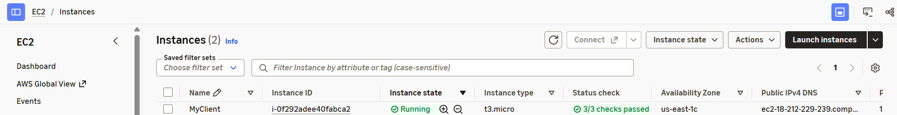
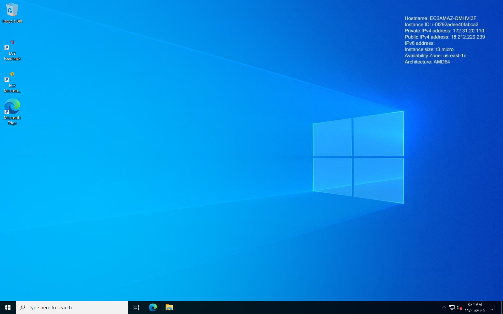
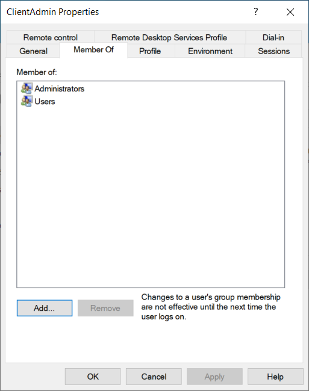
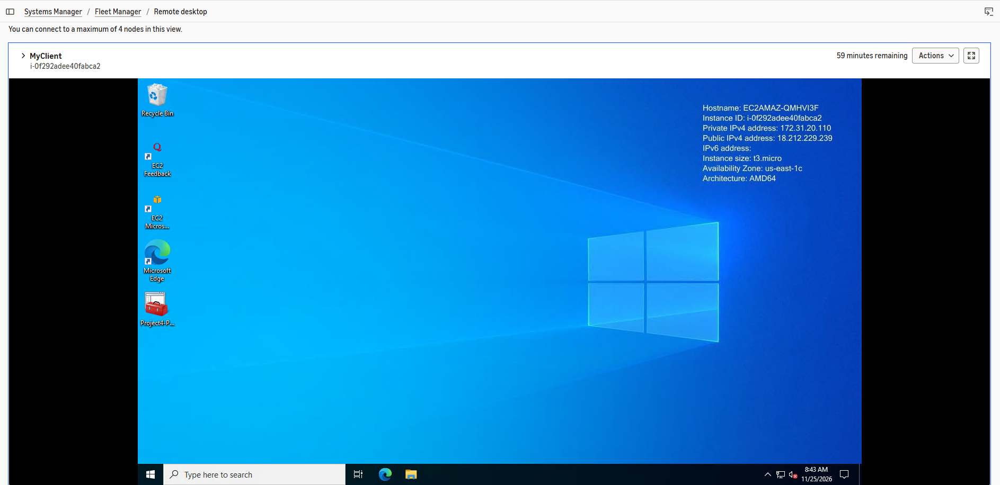
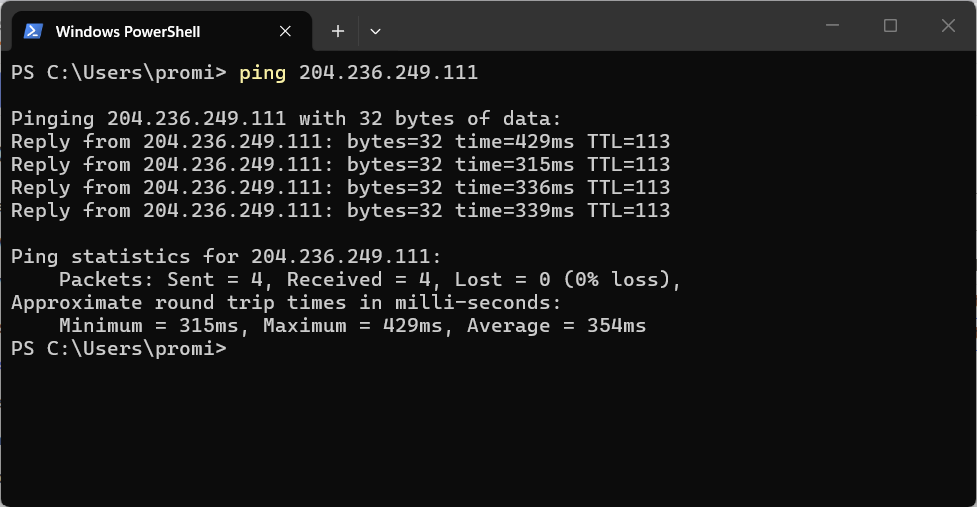

# Week 01: AWS EC2 Windows Server 2022 Deployment & Remote Management

[← Back to Master Project Overview](../../README.md)

## Objective
This first phase deploys a **Windows Server 2022** virtual machine (`MyClient`) in **Amazon Web Services (AWS) EC2** (`us-east-1c`). It establishes a cost-optimized (`t3.micro`) cloud workstation, configures a persistent local administrator (`ClientAdmin`), enables browser-based remote desktop sessions via **AWS Systems Manager Fleet Manager**, and verifies external ICMP network reachability.

---

## Instance & Network Specifications
* **Instance Name:** `MyClient`
* **Instance ID:** `i-0f292adee40fabca2`
* **AMI:** Microsoft Windows Server 2022 Base
* **Instance Type:** `t3.micro` (30 GiB EBS Storage)
* **Availability Zone:** `us-east-1c`
* **Public IPv4 Address:** `18.212.xxx.xxx`
* **Private IPv4 Address:** `172.31.84.12`

---

## Step-by-Step Build & Proof of Work

### 1. Provisioning the EC2 Virtual Machine
Launched a Windows Server 2022 Base virtual machine named `MyClient` on a `t3.micro` tier and generated an RSA key pair (`MyClient.pem`) to decrypt the initial Administrator password.

  
   
  <em>Figure 1.1: AWS EC2 console confirming <code>MyClient</code> (<code>i-0f292adee40fabca2</code>) is running on <code>t3.micro</code> in <code>us-east-1c</code> with 3/3 status checks passed.</em>

 

---

### 2. Initial Connection via Remote Desktop (RDP)
Decrypted the Administrator password using `MyClient.pem` and established an authenticated RDP session over TCP port `3389`.

  
   
  <em>Figure 1.2: Initial authenticated Remote Desktop session displaying the Windows Server 2022 graphical interface.</em>

 

---

### 3. Local Administrator Account Configuration
Created a persistent local administrator account (`ClientAdmin`) with a non-expiring password and added it to the built-in `Administrators` group via Computer Management.

  
   
  <em>Figure 1.3: Local Users and Groups properties confirming <code>ClientAdmin</code> is an active member of the Administrators group.</em>

 

---

### 4. Browser-Based Access with AWS Fleet Manager
Configured AWS Systems Manager Quick Setup (Host Management) to attach required IAM policies and the EC2 Launch Agent, enabling full-screen browser-based RDP sessions without a local client.

  
   
  <em>Figure 1.4: Full-screen Windows Server 2022 desktop session running inside the browser via AWS Systems Manager Fleet Manager.</em>

 

---

### 5. Network Connectivity Verification
Retrieved the instance's assigned Public and Private IPv4 addresses and verified external network reachability from a local workstation using `ping`.

  
   
  <em>Figure 1.5: Local Command Prompt confirming 0% packet loss when pinging the <code>MyClient</code> Public IPv4 address.</em>

 
---

## Cost Stewardship & Cleanup
To preserve the **$25 AWS lab budget** ahead of Week 2, `MyClient` was safely **Stopped** in the AWS Console and the Vocareum lab session was ended without selecting *Cleanup Lab*.