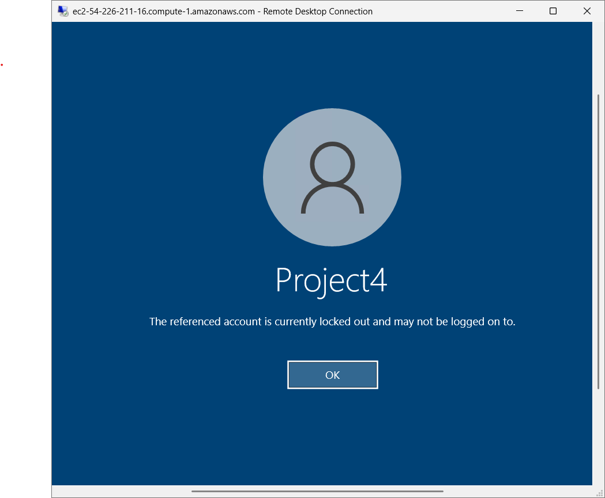
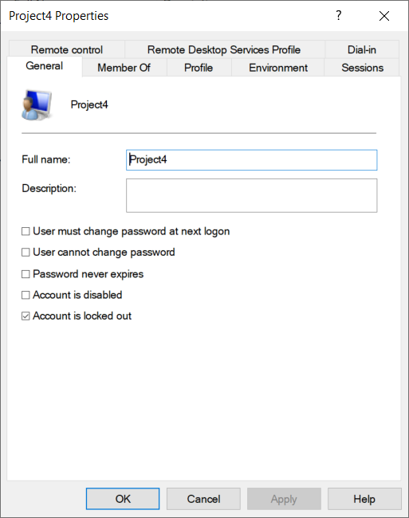
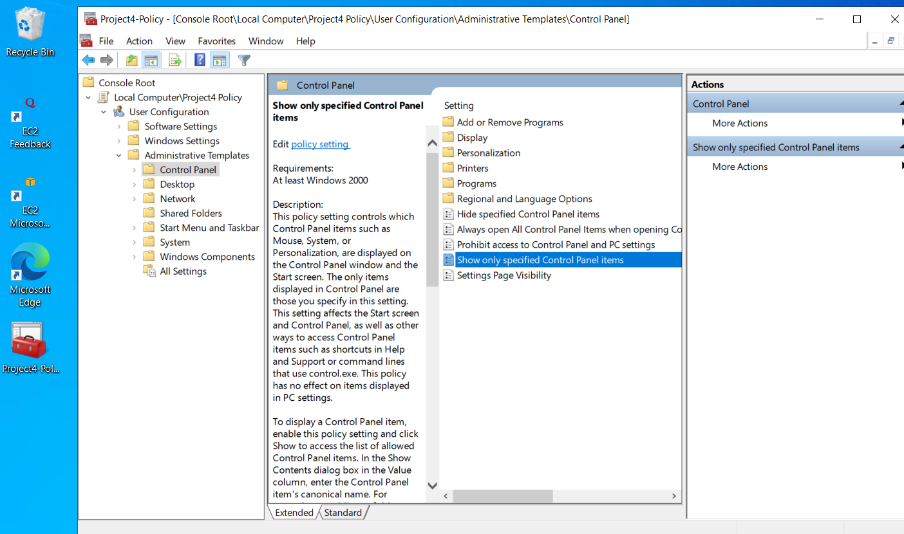
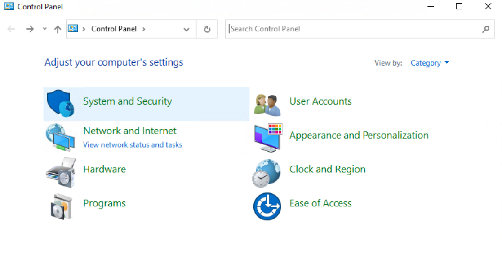
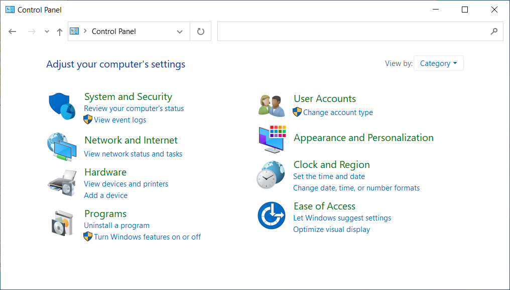
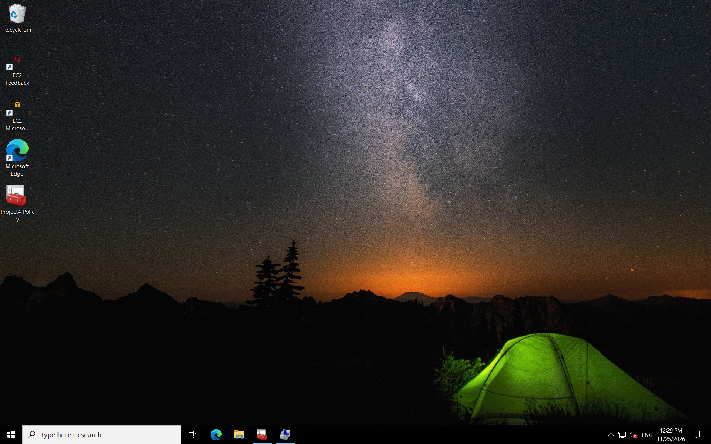
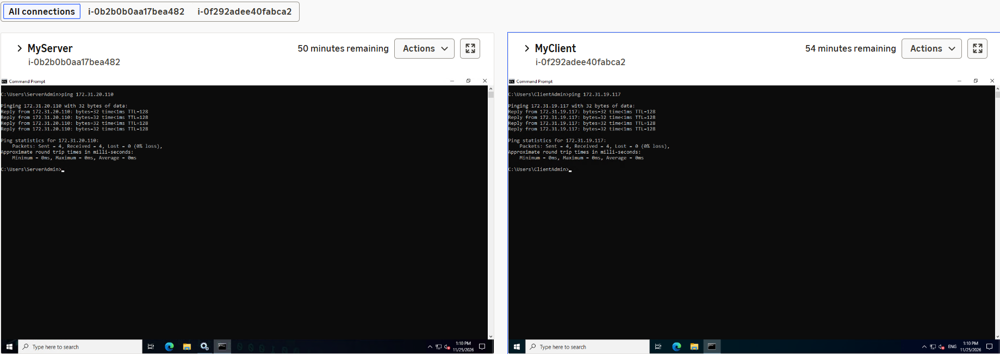
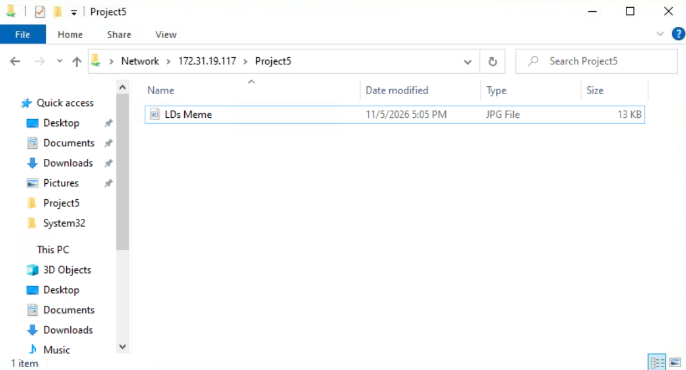
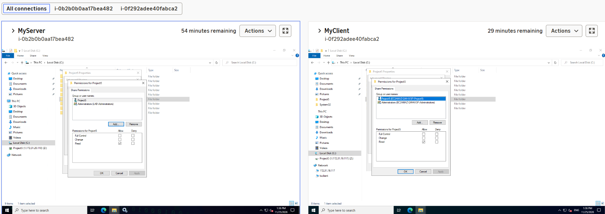

# Week 02: Local Security Policy, User-Specific GPOs & Peer-to-Peer File Sharing

[← Back to Master Project Overview](../README.md)

## Goals & Key Concepts
* **Goal:** Harden standalone Windows Server 2022 security with account lockout thresholds and user-scoped Group Policy Objects (GPOs), and configure authenticated peer-to-peer (P2P) SMB file sharing across a two-node `WORKGROUP` environment in AWS EC2.
* **Key Concepts:**
  * **Local Security Policy (`secpol.msc`):** Enforces machine-level password and account lockout rules on non-domain systems.
  * **Multiple Local Group Policy Objects (MLGPO via `mmc.exe`):** Targets UI and Control Panel restrictions to specific standard users without locking out local administrators.
  * **Peer-to-Peer (P2P) SMB Networking:** Shares folders across independent hosts using `Private` network profiles, UNC paths (`\\<IP>\Share`), matching local user credentials, and Share/NTFS Access Control Lists (ACLs).

---

## Environment Specifications

| Node Name | Operating System & Tier | Network Profile / Workgroup | Role |
| :--- | :--- | :--- | :--- |
| **MyClient** | Windows Server 2022 Base (`t3.micro`) | Private Network / `WORKGROUP` | Primary client node & GPO target host |
| **MyServer** | Windows Server 2022 Base (`t3.micro`) | Private Network / `WORKGROUP` | Peer file server & side-by-side Fleet Manager host |

---

## Part 1: Local Security Policy & User-Specific Group Policy

### 1. Account Lockout Policy Enforcement
Provisioned a standard local user account (`Project4`), granted Remote Desktop access, and configured **Local Security Policy (`secpol.msc`)** with an **Account lockout threshold** of `3` invalid logon attempts and a `3`-minute lockout duration. Verified enforcement by exceeding the failed logon threshold.

  
  
<em>Figure 2.1: Windows logon screen blocking authentication after exceeding the 3-attempt account lockout threshold.</em>

  

### 2. Administrative Lockout Verification & Recovery
Authenticated as `ClientAdmin` within the 3-minute lockout window to inspect the account state in **Computer Management → Local Users and Groups** and manually clear the lockout flag.

  
  
<em>Figure 2.2: Local Users and Groups properties confirming the "Account is locked out" flag is active on the Project4 user object.</em>

  

### 3. User-Specific Group Policy Scoping (`mmc.exe`)
Created a targeted Multiple Local Group Policy Object (MLGPO) via **Microsoft Management Console (`mmc.exe`)** bound exclusively to `Project4` and saved the console to the Desktop.

  
  
<em>Figure 2.3: Custom Microsoft Management Console (MMC) shortcut scoped specifically to the Project4 user account.</em>

  

### 4. Restricted Standard User Control Panel Verification
Enabled **Show only specified Control Panel items** using the canonical identifier `Microsoft.NetworkAndSharingCenter` inside the `Project4` GPO and verified that all other Control Panel applets were hidden during a `Project4` session.

  
  
<em>Figure 2.4: Control Panel view under the Project4 session restricted exclusively to the Network and Sharing Center.</em>

  

### 5. Unrestricted Administrator Access Verification
Authenticated as `ClientAdmin` to confirm administrative Control Panel tools remained completely unaffected by the user-scoped `Project4` GPO.

  
  
<em>Figure 2.5: Unrestricted Control Panel view under ClientAdmin proving administrative isolation from the Project4 GPO.</em>

  

### 6. Custom Desktop Personalization
Applied a custom desktop background image via **Settings → Personalization → Background** on the Windows Server 2022 instance.

  
  
<em>Figure 2.6: Windows Server 2022 desktop displaying the applied custom wallpaper configuration.</em>

  

---

## Part 2: Peer-to-Peer (P2P) Networking & SMB File Sharing

### 7. Dual-VM Workgroup & Network Discovery
Deployed a second Windows Server 2022 instance (`MyServer`) within the same AWS VPC and Security Group, connected both nodes side-by-side in **Fleet Manager**, set both network adapters to **Private**, and enabled **Network Discovery** and **File and Printer Sharing**.

  
  
<em>Figure 2.7: Bidirectional ICMP connectivity and Workgroup visibility verified between MyClient and MyServer.</em>

  

### 8. SMB Folder Sharing & UNC Path Access
Created `C:\Project5` on both instances, stored test media inside the directory, and accessed the remote share over TCP port `445` via UNC path (`\\<Target-Private-IP>\Project5`).

  
  
<em>Figure 2.8: Remote Project5 SMB share accessed over the internal VPC network displaying the shared image file.</em>

  

### 9. Persistent Drive Mapping & Least-Privilege Share ACLs
Mapped the remote share to drive letter `Z:` (`net use z: \\<Target-Private-IP>\Project5`), created matching local `Project5` user accounts on both hosts, removed the `Everyone` group from Share permissions, and granted Read access exclusively to `Project5`.

  
  
<em>Figure 2.9: Mapped Z: network drive authenticated as Project5 with Share ACLs hardened to exclude Everyone.</em>

  

---

## Problems & Fixes

* **Global Control Panel Lockout (`gpedit.msc`):** Configuring *Show only specified Control Panel items* in standard `gpedit.msc` restricted `ClientAdmin` as well as `Project4`. **Fix:** Disabled the global policy in `gpedit.msc` and created a user-specific Local GPO bound strictly to `Project4` using `mmc.exe`.
* **Blocked Ping & Discovery Between EC2 Nodes:** `MyServer` initially defaulted to a **Public** network profile, blocking ICMP echo requests and SMB discovery from `MyClient`. **Fix:** Switched the network adapter profile to **Private**, enabled **Network Discovery** and **File and Printer Sharing**, and ensured both instances shared the same AWS Security Group rules.
* **Administrator Denied Access to `Project5` Share:** Replacing `Everyone` with `Project5` in the Share permissions locked out `ClientAdmin` and `ServerAdmin` due to Windows evaluating the most restrictive combination of Share and NTFS ACLs. **Fix:** Authenticated via pass-through credentials using matching local `Project5` user accounts on both machines.

---

## Lab Teardown
* Stopped both `MyClient` and `MyServer` EC2 instances in the AWS Management Console.
* Ended the Vocareum lab session without triggering *Cleanup Lab* to preserve instance configurations for Week 03.